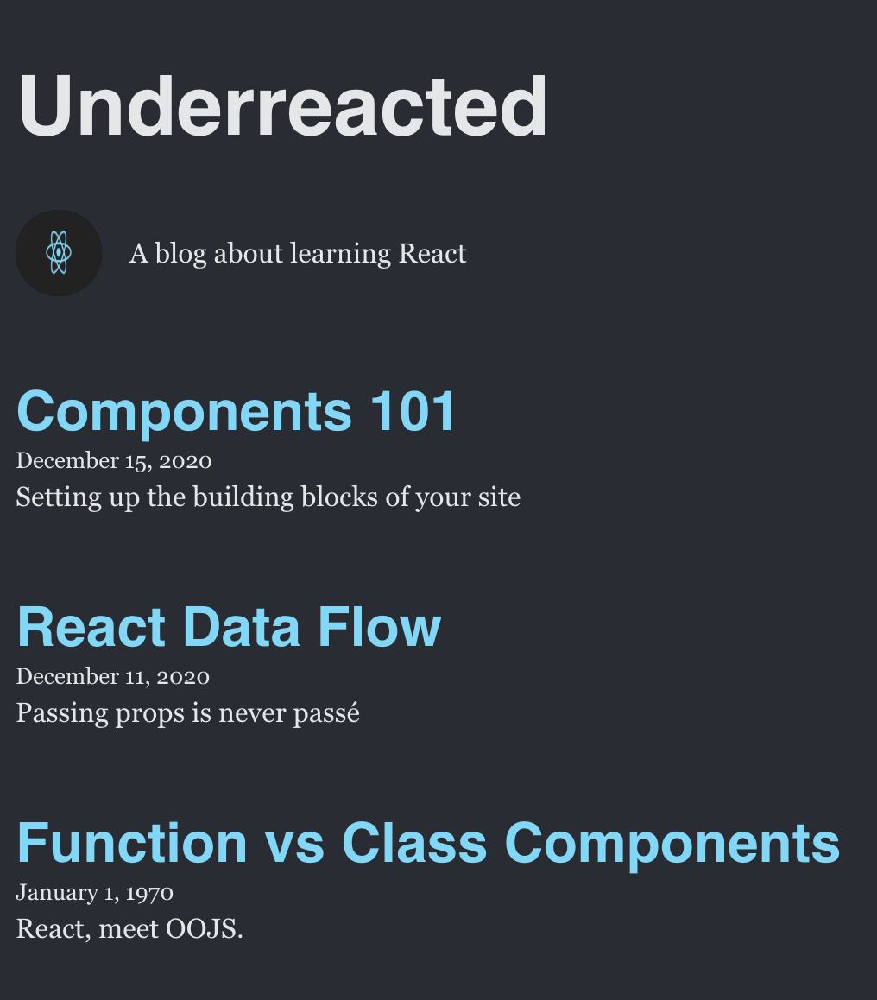

# Blog Site

A static personal blog built with React and Vite. Blog content lives in `src/data/blog.js`, is imported into `App.jsx`, and is passed down to child components as props.

## How to run

1. Clone the repo and `cd` into it
2. `npm install`
3. `npm run dev` and open the local URL printed in the terminal
4. `npm test` to run the tests

## Screenshot



## Component tree

```
App
├── Header
├── About
└── ArticleList
    └── Article
```

## Components

- **App**: Imports `blog.js` and passes data to its children (Header, About, ArticleList).
- **Header**: Renders the blog name in an `<h1>`. Receives `name`. Child of App.
- **About**: Renders the logo and blurb in an `<aside>`. Receives `image` and `about`. Child of App.
- **ArticleList**: Maps over `posts` and renders one Article per post, using each post's `id` as the key. Receives `posts`. Child of App; parent of Article.
- **Article**: Renders one post's title, date, and preview. Receives `title`, `date`, `preview`. Defaults the date when none is given. Child of ArticleList.